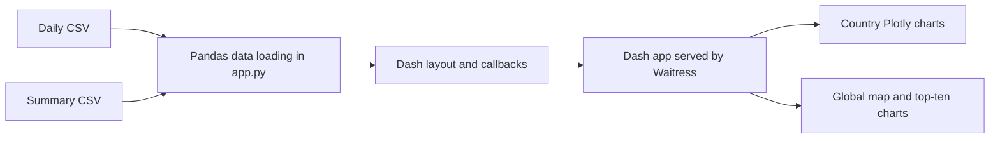

# Global COVID-19 Data Dashboard

## Project overview

The repository owner's Python Dash application for visualizing static, historical COVID-19 country summaries and daily time series using Plotly. It is not a live data service, clinical tool, or source of public-health advice. No deployment or runtime was verified for this portfolio preparation.

## Key features

- Country-level charts for active cases, cumulative cases, daily new cases, and a summary-derived fatality rate.
- Global confirmed-case choropleth and top-ten confirmed-case/death charts.
- Local CSV loading, with a country selector used by country-specific views.

## Technology stack

Python 3.9 is declared in `app.yaml`. The requirements file pins Dash, pandas, Plotly, and Waitress among its packages. The upstream `requirements.txt` is UTF-16 LE encoded; compatibility with pip was not verified. The local G2 working copy has an encoding-only normalization, but that file is excluded from this publication batch.

## Architecture and workflow

The global map and top-ten callbacks currently accept, but do not apply, the selected country.

## Project structure

| Path | Purpose |
|---|---|
| `app.py` | CSV loading, Dash layout, chart callbacks, and Waitress startup |
| `requirements.txt` | Pinned Python dependencies |
| `app.yaml` | Declared runtime, entry point, and static-file configuration |
| `datasets/` | Summary and daily CSV inputs in the upstream repository |

## Setup and usage

The upstream repository tracks both CSV inputs; the local preparation copy omits the approximately 8.6 MB daily CSV and is not runnable as checked out. After confirming that the upstream manifest can be read by your installer and both files are present, create a Python 3.9 environment, install `requirements.txt`, and run `python app.py`. The app binds to `0.0.0.0` and uses `PORT`, defaulting to `8080`. These instructions reflect static source/configuration, not a verified run.

## Technical highlights

The application derives a fatality-rate field, renders country and global views, and serves Dash through Waitress. Its use of relative data paths makes startup dependent on the working directory.

## Limitations

The CSV loading handler prints broad exceptions and continues although later code requires the data frames. The data are static and their vintage is unclear. The global views ignore the selector; no tests, CI, or verified live instance were found. No analytical result or deployment claim is made.

## Attribution and data sources

The CSV filenames reference Worldometer, while the former README also named Johns Hopkins University without mapping exact sources to files. Exact source URLs, snapshot dates, attribution, and usage terms remain unverified. The author implemented the dashboard; ownership and reuse rights for third-party data are not claimed. No root license was found or added; confirm data rights before redistribution.

## Author and contact

Repository: [@irtezasyed01](https://github.com/irtezasyed01). The repository owner confirms the dashboard implementation; third-party data remains subject to its own attribution and reuse terms.
